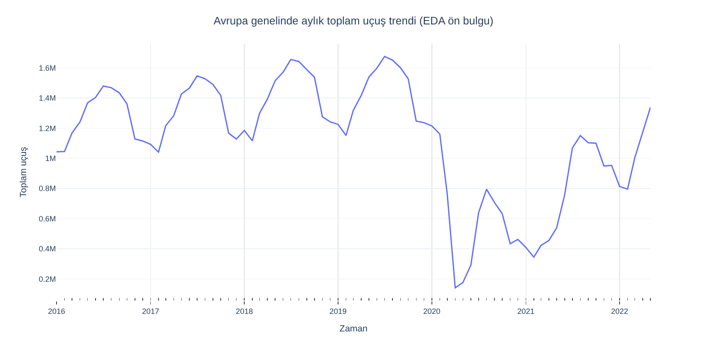
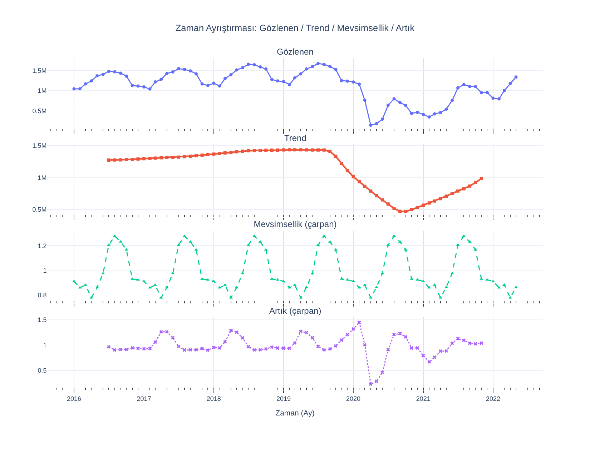
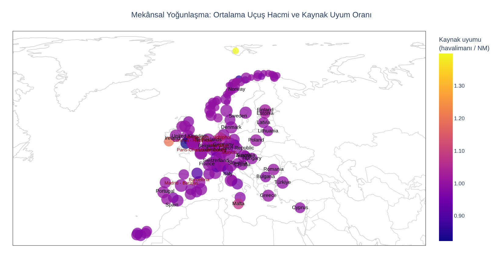

# European Airport Traffic Analysis (2016–2022)

**How does air traffic in Europe change over time, where is it concentrated, and how reliable are the two data sources that record it?**

An exploratory data analysis and visualisation project on **688,099 monthly records from 332 European airports**
(January 2016 – May 2022), built in Python with interactive Plotly charts.

📊 **Interactive charts:** [melikegllnv.github.io/european-airport-traffic-analysis](https://melikegllnv.github.io/european-airport-traffic-analysis/)



---

## Key findings

**1. Strong seasonality, steady growth — then a structural break.**
Traffic grew steadily from 2016 to 2019, peaking at about **1.68 million flights per month** in summer 2019.
Summer months run about 28% above the yearly average and winter months about 22% below it.
In **April 2020, traffic fell 90%** compared with April 2019. April and May 2020 are the only months flagged as statistical
anomalies (residual z-score below −3). By May 2022, traffic had recovered to **87% of its May 2019 level**.



**2. Traffic is highly concentrated.**
Just **83 airports (about 25%) handle 80% of all flights**. Amsterdam, Paris CDG, Frankfurt, London Heathrow and Madrid
carry the most traffic, and the busiest region is Western and Central Europe — a clear hub-and-spoke structure.



**3. Data quality: two sources, one measurement.**
The dataset records IFR flights from two sources: EUROCONTROL's Network Manager and the airport operators themselves.
- **200 of the 332 airports never report** airport-operator data, so that source covers only part of the network.
- Where both sources exist for the same month, they **agree within ±5% at about 90% of airports** (median ratio 0.998).
- The large hubs report almost every month and match the Network Manager almost exactly; the biggest gaps appear at a
  few small airports (for example Svalbard Longyear, about 1.4×).

**Practical takeaway:** for Europe-wide analysis, the Network Manager series is the complete and consistent one;
airport-operator figures are a useful cross-check but should be validated airport by airport.

## Data

[TidyTuesday — European flights (2022-07-12)](https://github.com/rfordatascience/tidytuesday/blob/main/data/2022/2022-07-12/readme.md),
originally from the EUROCONTROL Aviation Intelligence Portal. Airport coordinates from [OurAirports](https://ourairports.com/data/)
(99.4% of airports matched by ICAO code). Both datasets are downloaded automatically when the notebook runs.

## Method

1. **Data profiling** — variable catalogue, missing / zero / negative value checks.
2. **Outlier analysis** — IQR method; high outliers turn out to be the major hubs, not data errors.
3. **Distribution analysis** — ECDF and log-scale histogram of monthly traffic.
4. **Concentration analysis** — cumulative share of traffic by airport.
5. **Time series analysis** — monthly trend, year × month heatmap, multiplicative decomposition, z-score anomaly detection (statsmodels).
6. **Spatial analysis** — geocoding by ICAO code and an interactive map of traffic volume and source agreement.
7. **Source comparison** — airport-operator vs Network Manager counts by airport and over time.

Each chart in the notebook comes with a short visual-encoding table (mark, channels, data types), following
data-visualisation design principles.

## Repository structure

```
├── notebooks/
│   └── european_airport_traffic_analysis.ipynb   # full analysis (Turkish commentary)
├── docs/                                         # interactive charts (GitHub Pages)
├── images/                                       # static chart previews
└── requirements.txt
```

## How to run

```bash
pip install -r requirements.txt
jupyter notebook notebooks/european_airport_traffic_analysis.ipynb
```

Or open the notebook in [Google Colab](https://colab.research.google.com/).

## Tools

Python · pandas · NumPy · statsmodels · Plotly · Matplotlib · Seaborn · Jupyter / Google Colab

---

*Originally prepared for the Data Visualisation course (VBM661) of the MSc in Information Systems, Hacettepe University.
Revised in November 2026: the airport-operator / Network Manager metric was re-interpreted according to the official data dictionary,
and two charts were improved.*

**Melike Gullanova** · [GitHub](https://github.com/MelikeGllnv) · melike.gllnv@gmail.com
